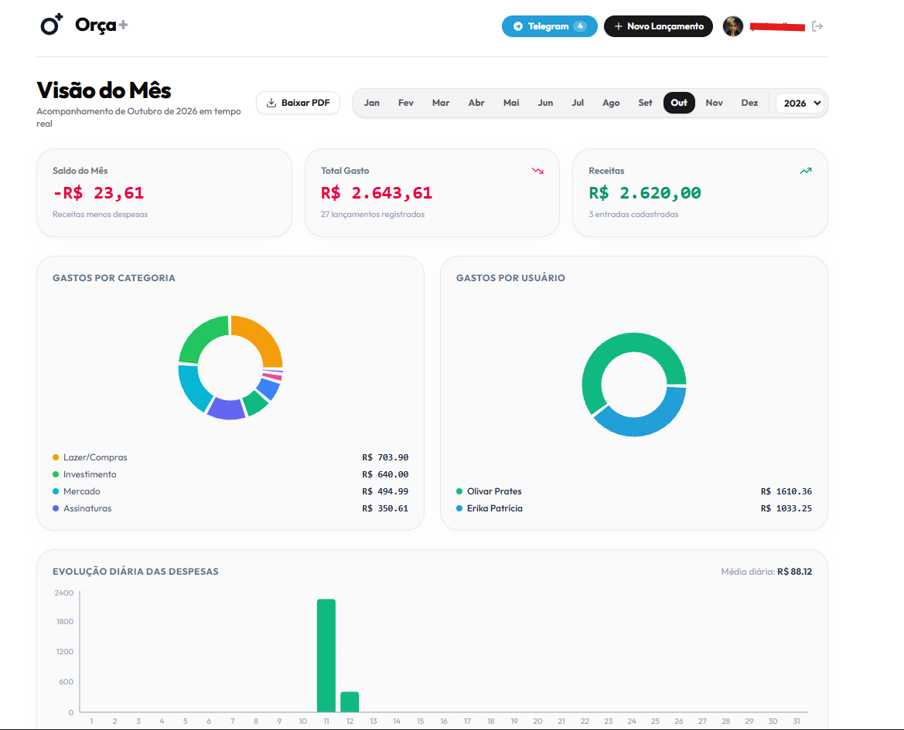
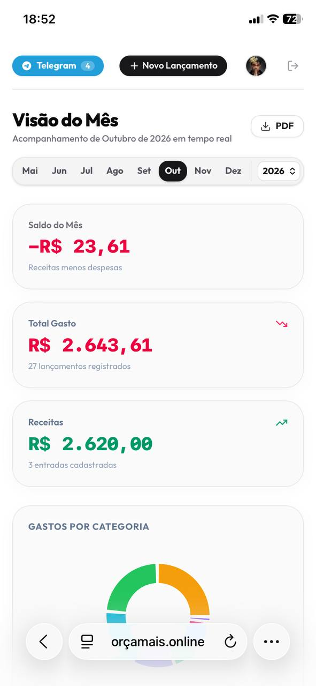
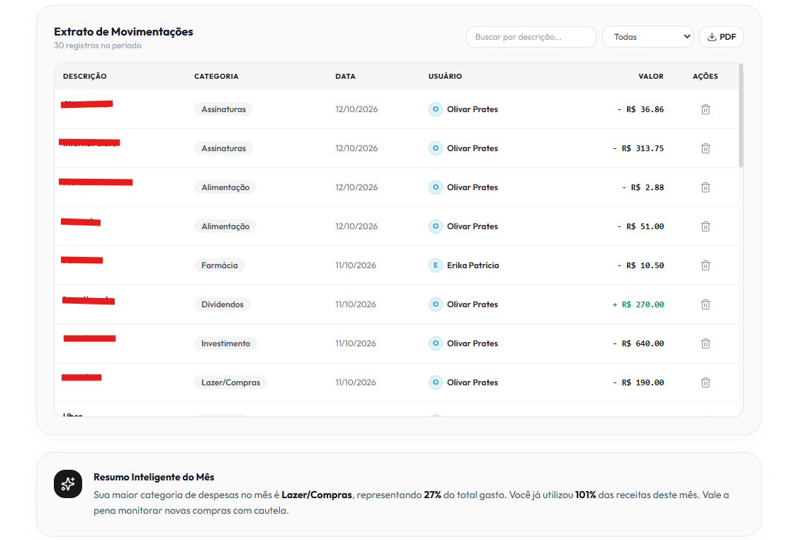
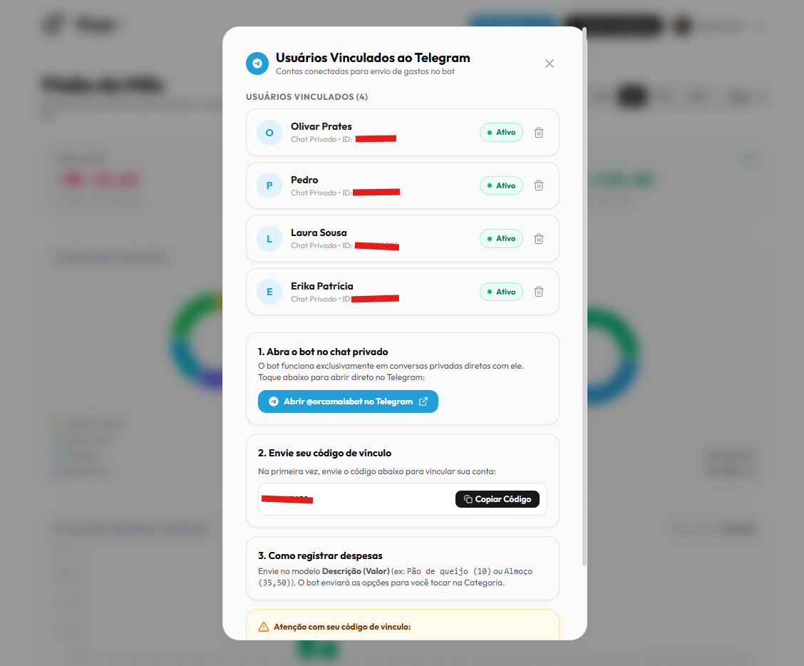
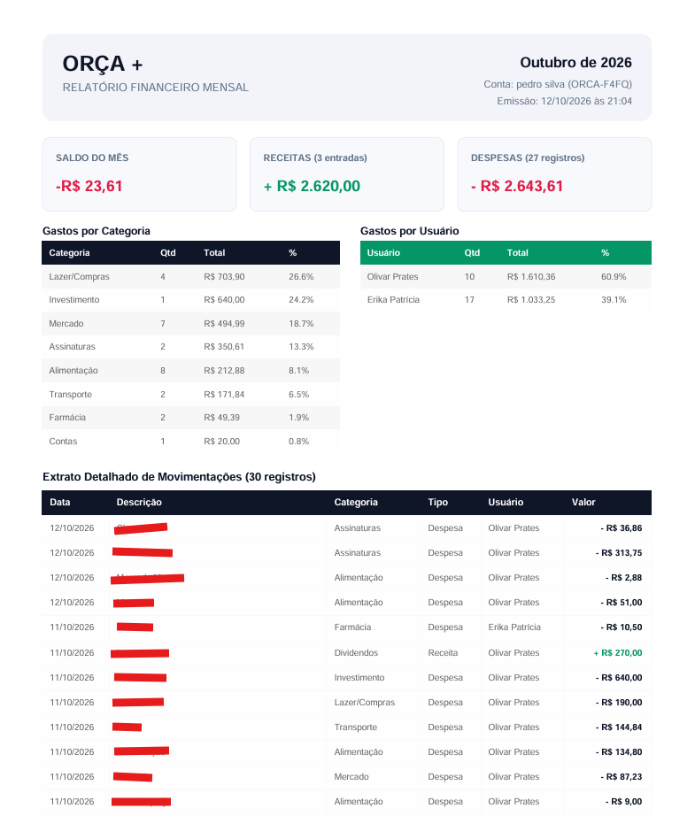
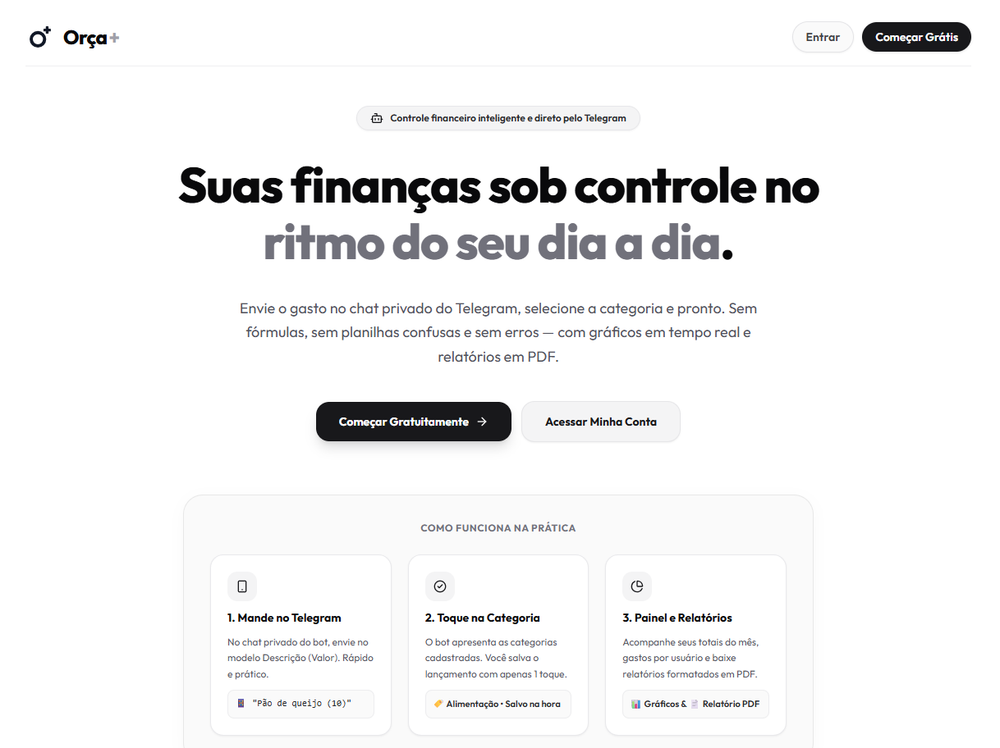
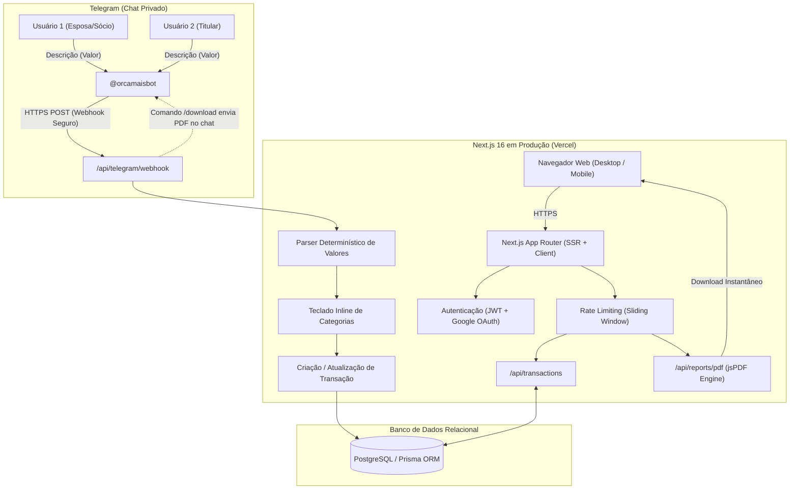

<div align="center">

# Orça +

**Controle financeiro pessoal e compartilhado direto pelo Telegram, com dashboard em tempo real e relatórios em PDF.**

Envie seus gastos pelo Telegram privado com modelo ágil e determinístico `Descrição (Valor)`, selecione a categoria em 1 toque e acompanhe tudo pelo painel web com gráficos, extrato e download de relatórios mensais.

[**orçamais.online**](https://orçamais.online) &nbsp;·&nbsp; produto no ar em produção, com webhook 24/7 e autenticação ativa

        

</div>

> **TL;DR (English):** Orça + is a production full-stack financial management platform designed for friction-free personal and shared expense tracking. Rather than forcing users to open heavy mobile apps or fill clunky spreadsheets, users log expenses directly inside private Telegram chats using a deterministic parsing pattern (e.g. `Almoço (35,50)`). Features multi-user shared tracking with link codes for couples or partners, real-time analytics dashboard, server-side PDF report compilation (jsPDF), strict bcrypt password security, sliding-window IP rate limiting against brute-force attacks, and Google OAuth. The full source code is private; this repository documents the system architecture, engineering decisions, and includes tested code samples.

---

## O problema

A maioria dos aplicativos de controle financeiro falha pelo excesso de atrito no dia a dia: exigem que o usuário abra o app, digite senha, navegue por vários menus e selecione formulários lentos enquanto ainda está no caixa ou na rua. Já planilhas manuais tornam-se caóticas quando duas pessoas (casal ou sócios) tentam registrar gastos juntos sem sincronização em tempo real.

O **Orça +** resolve isso colocando o ponto de entrada onde as pessoas já passam o dia: uma conversa privada no Telegram. Em menos de 3 segundos, o gasto é validado, classificado e refletido no painel web protegido.

---

## Como funciona para o usuário

1. **Registro em 1 toque no Telegram:** O usuário envia uma mensagem curta no modelo `Descrição (Valor)` (ex: `Mercado (125,50)` ou `Combustível (80)`). O bot valida o formato e exibe botões inline para categorização instantânea.
2. **Contas Compartilhadas (Casais ou Sócios):** Cada conta gera um código de vínculo exclusivo (`ORCA-XXXX`). A outra pessoa envia esse código no Telegram dela e ambas as contas passam a alimentar o mesmo painel, com identificação clara de quem registrou cada despesa.
3. **Painel & Relatórios Web:** No navegador (mobile ou desktop), o usuário visualiza gráficos interativos de pizza (por Categoria e por Usuário), evolução diária, extrato com filtros e gera relatórios em PDF completos com um clique (ou pelo comando `/download` no Telegram).

---

## Telas

> Capturas do produto em produção rodando na Vercel com dados de exemplo.

| Dashboard — Visão do Mês (Desktop) | Dashboard & Bot (Mobile) |
|---|---|
|  |  |

| Extrato Filtrável & Gráficos | Modal Telegram & Vínculo Multi-usuário |
|---|---|
|  |  |

| Relatório Mensal em PDF | Landing Page & FAQ |
|---|---|
|  |  |

---

## Destaques técnicos

| Tema | O que foi feito | Detalhes |
|---|---|---|
| **Parsing determinístico em alta velocidade** | Extração de descrição e valor via expressões regulares calibradas para a moeda brasileira (`R$`, separadores de milhar e centavos), sem latência ou custo de chamadas desnecessárias de IA. | [`parse-message.ts`](code-samples/typescript/parse-message.ts) |
| **Multi-usuário com segregação e auditoria** | Vínculo entre chats privados e conta mestre via código alfanumérico único. Cada transação armazena o autor original, permitindo gráficos de participação nos gastos. | [`architecture.md`](docs/architecture.md) |
| **Proteção contra força bruta (Rate Limiting)** | Limitador por janela deslizante (*sliding window*) com extração de IP real (compatível com proxies e Vercel), aplicando HTTP 429 com cabeçalhos `Retry-After` nos endpoints de login, cadastro, PDF e transações. | [`rate-limit.ts`](code-samples/typescript/rate-limit.ts) |
| **Criptografia e segurança de credenciais** | Hashing de senhas com `bcryptjs` (custo 10), validação no servidor (6 a 72 caracteres), cookies `httpOnly`, `sameSite: lax` e `secure`, além de assinaturas HMAC comparadas em tempo constante com `crypto.timingSafeEqual`. | [`auth-session.ts`](code-samples/typescript/auth-session.ts) |
| **Geração de PDF no servidor** | Compilação dinâmica de documentos PDF com `jsPDF`, formatando balanço financeiro, resumo de entradas/saídas e tabela zebrada de transações com saída em buffer binário para web e Telegram. | [`pdf-report.ts`](code-samples/typescript/pdf-report.ts) |
| **Prevenção de IDOR e vazamento** | Consultas e exclusões de registros sempre amarradas ao `userId` da sessão ativa (`prisma.transaction.deleteMany({ where: { id, userId } })`), impedindo exclusão ou visualização cruzada de dados. | [`security.md`](docs/security.md) |
| **Design System minimalista** | Interface monocromática refinada, tipografia sem serifa de alta legibilidade, contraste acessível e preservação estrita de cores funcionais (receita verde, despesa vermelha). | [Documentação visual](docs/architecture.md#design-system) |

---

## Arquitetura



Mais detalhes sobre o fluxo de requisição, ciclo de vida e modelagem de dados em [`docs/architecture.md`](docs/architecture.md).

---

## Stack

- **Front-end:** Next.js 16 (App Router, React 19), TypeScript, Tailwind CSS, Lucide Icons, Recharts (gráficos dinâmicos).
- **Back-end:** Next.js API Routes (Node.js runtime), rotas REST protegidas, Rate Limiting em memória por IP.
- **Banco de Dados & ORM:** PostgreSQL hospedado na nuvem (Neon), Prisma ORM com tipagem estrita e migrações versionadas.
- **Autenticação:** Sessões baseadas em JWT assinado via HMAC-SHA256, cookies de segurança (`httpOnly`, `sameSite: lax`, `secure`), integração com Google OAuth 2.0 e senhas com `bcryptjs`.
- **Mensageria & Bot:** Telegram Bot API (Webhooks HTTPS, Inline Keyboards, envio de documentos e mensagens formatadas em HTML).
- **Relatórios:** `jsPDF` com layout customizado, tipografia tabular e paleta monocromática com destaques de saldo.
- **Hospedagem & CI/CD:** Vercel com deploy automatizado via Git, domínio próprio com DNS configurado e SSL/TLS ponta a ponta.

---

## Sobre o código-fonte

O repositório do aplicativo é **privado**. Neste repositório público de portfólio você encontra a documentação técnica completa e amostras de código testadas e comentadas:

```
repositorio/
├── README.md              # Você está aqui
├── docs/
│   ├── architecture.md    # Arquitetura do webhook, ciclo de vida e banco
│   ├── security.md        # Relatório de cibersegurança, rate limit e criptografia
│   └── skills.md          # Mapa de competências técnicas demonstradas
├── code-samples/
│   ├── typescript/
│   │   ├── parse-message.ts   # Parser regex de moeda e descrição brasileira
│   │   ├── rate-limit.ts      # Sliding window rate limiter para API Routes
│   │   ├── auth-session.ts    # Hashing bcrypt, assinatura JWT e timing-safe comparison
│   │   └── pdf-report.ts      # Motor de geração programática de relatório PDF
│   └── prisma/
│       └── schema.prisma      # Esquema relacional com modelos User, Chat, Transaction, Category
└── assets/
    └── screenshots/           # Capturas de tela do produto em funcionamento
```

---

## Competências demonstradas

- **Engenharia Full-Stack:** Desenvolvimento de ponta a ponta de uma solução web moderna com Next.js 16 e TypeScript.
- **Integração de Webhooks & Bots:** Arquitetura de mensageria assíncrona com a Telegram Bot API para entrada de dados em tempo real.
- **Segurança de Aplicações Web:** Rate limiting ativo contra força bruta, hashing de senhas com `bcrypt`, mitigação de timing attacks e proteção contra IDOR.
- **Modelagem de Banco de Dados:** Relacionamentos 1:N, agregações financeiras e transações consistentes com Prisma ORM e PostgreSQL.
- **Geração de Documentos no Servidor:** Compilação sob demanda de relatórios contábeis em PDF com jsPDF.
- **Design System & UX:** Criação de interface moderna, minimalista e monocromática, otimizada para uso em telas mobile e desktop.

O mapa detalhado de competências com referências cruzadas está disponível em [`docs/skills.md`](docs/skills.md).

---

## Contato

**Pedro Silva** · [LinkedIn](https://www.linkedin.com/in/pedro-lucas-silva-6b1678358/?isSelfProfile=true) · [pedrol09872@gmail.com](mailto:pedrol09872@gmail.com)

---

## Licença

Todos os direitos reservados. Os textos, imagens e trechos de código deste repositório são apresentados para fins de portfólio e consulta; não podem ser reutilizados comercialmente sem autorização prévia.
